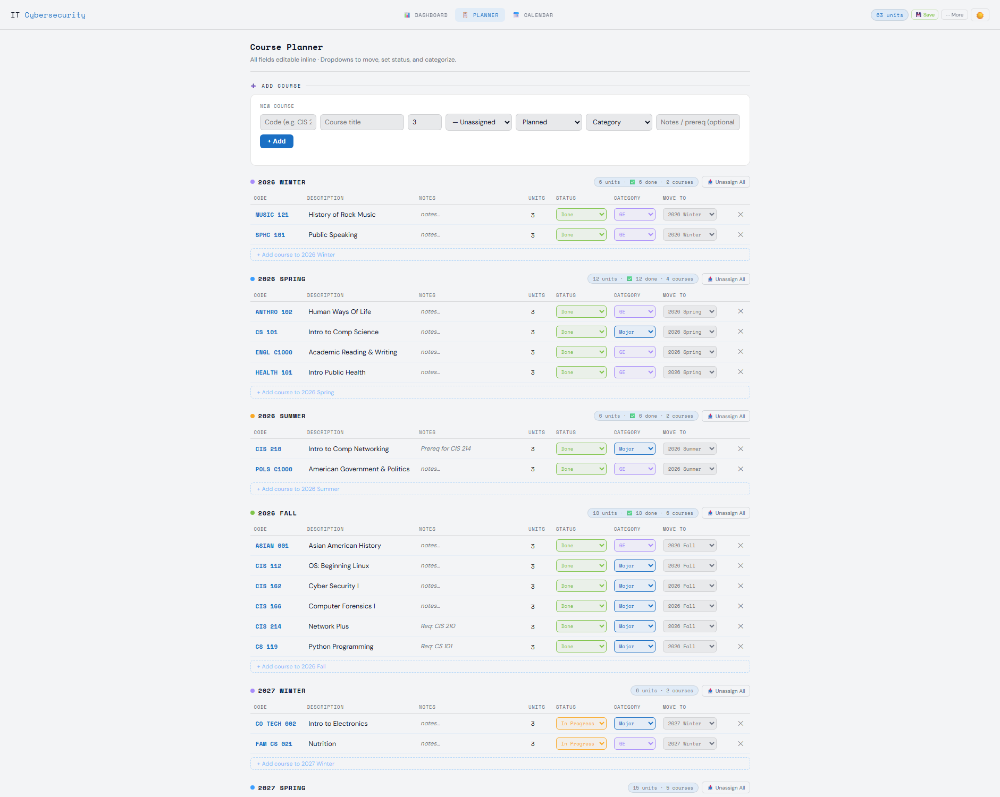

# IT-Cybersecurity-Planner


A single-page record of my completed **IT Cybersecurity** coursework at Los Angeles City College — 21 courses, 63 units across six terms, including two credits transferred in from GCC.

🌐 **Live:** [nattapongsindhu.github.io/IT-Cybersecurity-Planner](https://nattapongsindhu.github.io/IT-Cybersecurity-Planner)



This is a personal record, not a product: the plan is final, so the app is built to *show* the pathway clearly and to keep the data honest over time.

---

## What it does

| Tab | What you get |
|---|---|
| **Dashboard** | Units done vs. goal, status donut, units per category, units per term, milestone badges |
| **Planner** | Every course by term, inline-editable (code, title, notes, units, status, category, term) |
| **Calendar** | Compact term timeline with per-course tooltips |

Also in **⋯ More**: export/import JSON, export CSV, print / PDF.

Everything is client-side. There is no build step, no framework, no backend and no tracking.

---

## The plan

| Term | Courses | Units | Status |
|---|---|---|---|
| 2026 Winter | MUSIC 121, SPHC 101 | 6 | done (transferred in) |
| 2026 Spring | ANTHRO 102, CS 101, ENGL C1000, HEALTH 101 | 12 | done |
| 2026 Summer | CIS 210, POLS C1000 | 6 | done |
| 2026 Fall | ASIAN 001, CIS 112, CIS 162, CIS 166, CIS 214, CS 119 | 18 | done |
| 2027 Winter | CO TECH 002, FAM CS 021 | 6 | in progress |
| 2027 Spring | CIS 170, CIS 191, CIS 211, CIS 212, CIS 213 | 15 | in progress |

Certification targets are tracked in each course's notes (A+ → Network+ → Security+).

---

## Data model

All data lives in one place: `const DEFAULT_COURSES` in [`index.html`](index.html).

```js
{id, code, title, units, sem, status, cat, notes}

code    'CIS 170'
title   'Intro to Ethical Hacking'
units   3
sem     'fa2026'          // sp/su/fa + year; 'wi2026' = 2026 Winter
status  'planned' | 'in-progress' | 'done'
cat     'other' | 'ge' | 'major' | 'elective'
notes   free text (prereqs, cert target)
```

Terms come from `const TERM_YEARS` + a fixed Spring → Summer → Fall → Winter pattern. The list is **deliberately independent of today's date**, so a past term can never silently disappear from the page. Add a year to `TERM_YEARS` if the plan ever grows.

### Editing the plan

1. Edit `DEFAULT_COURSES` (or use the UI — inline edits work too).
2. Run the checks:

   ```bash
   node scripts/check-data.js
   ```

   It fails on duplicate codes, non-numeric units, unknown status/category, a term outside `TERM_YEARS`, or an unexpected course count.
3. Commit and push — GitHub Pages publishes `main` automatically.

`scripts/check-data.js` also runs in CI on every push ([`.github/workflows/data-check.yml`](.github/workflows/data-check.yml)), together with a parse check of the inline script.

---

## Where your edits go

Inline edits are stored in `localStorage` under versioned keys (`itsec_planner_v11`, …):

- **New default courses are merged in on load**, so updating the plan no longer requires wiping stored data.
- **Courses you delete on purpose stay deleted** (tracked in `itsec_removed_v11`) — the merge will not resurrect them.
- `⋯ More → Load Default Plan` resets everything back to `DEFAULT_COURSES`.
- Export JSON before clearing browser data if you want a backup; import normalizes and re-validates the file.

---

## Run it locally

```bash
# no install needed
start index.html          # Windows
open index.html           # macOS

# checks
node scripts/check-data.js
```

Only external request is the Google Fonts stylesheet; offline it falls back to system fonts and the app still works.

---

## License

MIT — see [LICENSE](LICENSE).
